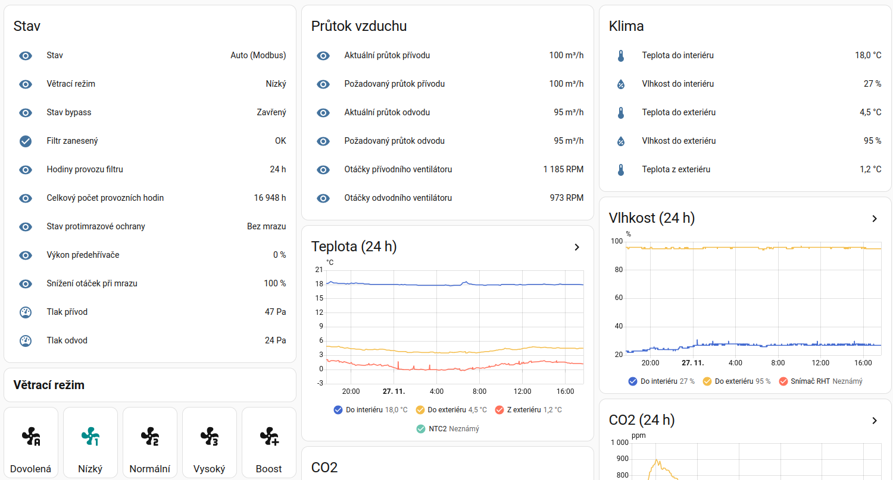
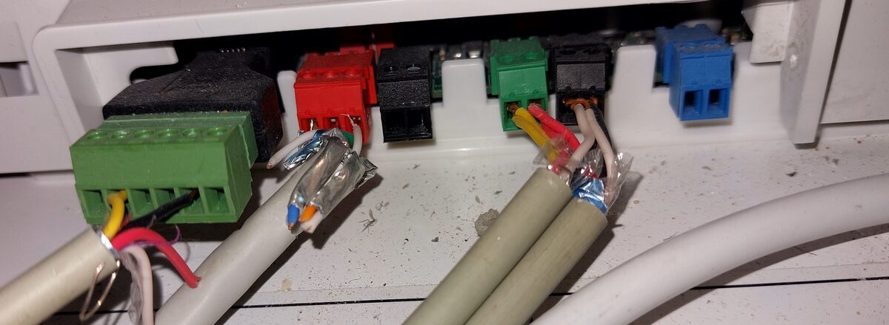
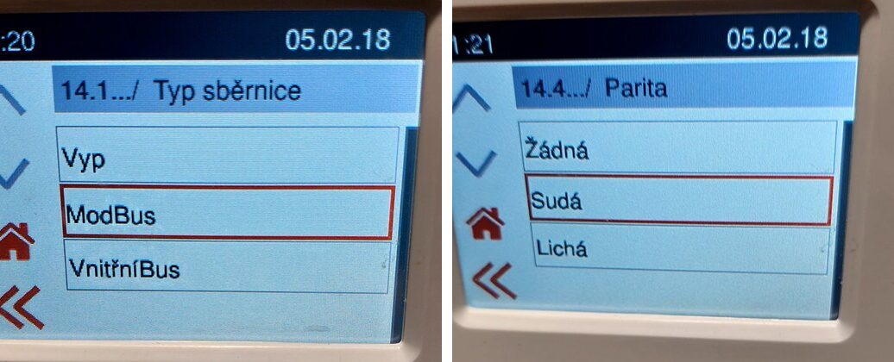
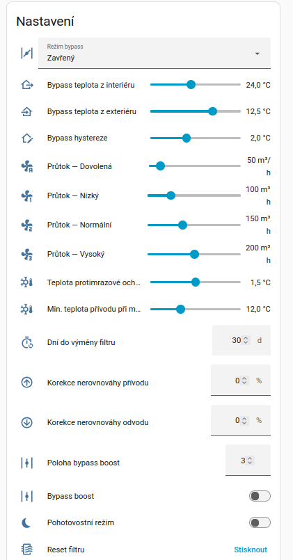

# Brink Flair — Home Assistant Custom Integration

[](https://hacs.xyz/)
[](https://github.com/Barracuda1984/ha-brink-flair/releases)
[](https://github.com/Barracuda1984/ha-brink-flair/actions/workflows/validate.yml)
[](https://www.home-assistant.io/)
[](LICENSE)

Control and monitor your **Brink Flair** heat-recovery ventilation unit from Home Assistant — directly over **Modbus RTU (RS-485)**, no ESP board, cloud or Brink gateway required.

- 📊 Temperatures, humidity, air flows, fan speeds, duct pressures, CO2 and filter status
- 🎛️ Ventilation mode, bypass mode, flow presets, bypass and frost-protection settings
- 🧹 Filter reset button and filter-dirty alert
- 🌍 Setup, states and error messages in English, Czech, Dutch, German and French
- 🩺 Downloadable diagnostics for bug and compatibility reports
- 🏠 Ready-made dashboards (EN/CS) and a Boost script



[](https://my.home-assistant.io/redirect/hacs_repository/?owner=Barracuda1984&repository=ha-brink-flair&category=integration)

## Compatibility

The integration is developed and tested on a **Flair 400**. Other Flair units use the same control board (UWA2-B / UWA2-E) and the same Modbus register map, so they are expected to work, but nobody has confirmed it yet.

| Model | Control board | Status | Reported by |
|-------|---------------|--------|-------------|
| Flair 400 | UWA2-B (X15) | ✅ Tested | [@Barracuda1984](https://github.com/Barracuda1984) |
| Flair 225 | UWA2-B / UWA2-E | ❓ Untested | — |
| Flair 325 | UWA2-B / UWA2-E | ❓ Untested | — |
| Flair 600 | UWA2-B / UWA2-E | ❓ Untested | — |

Tested environment: Flair 400 with firmware S3.01.05.0001 / hardware H2.1, Home Assistant OS 18.4, Core 2026.11.3, integration 1.1.0. The firmware and hardware versions are shown on the device page in Home Assistant.

**Have a different model?** Please file a [working model report](https://github.com/Barracuda1984/ha-brink-flair/issues/new?template=working_model.yml) — whether it works or not — and it will be added to this table.

## Requirements

- Home Assistant **2025.9.0** or newer (first release shipping pymodbus ≥ 3.10)
- An RS-485 adapter connected to the Home Assistant host (see [Hardware and wiring](#hardware-and-wiring))
- Modbus enabled on the Brink unit (see [Device configuration](#device-configuration))

## Hardware and wiring

### What you need

- **RS-485 adapter** — any RS-485 adapter that shows up as a serial port on the Home Assistant host works: a USB-to-RS485 dongle (FTDI, CH340, CP210x, …) or an RS-485 HAT for a Raspberry Pi. The integration uses plain Modbus RTU and needs no adapter-specific driver.
  - Example used on the Flair 400: [PremiumCord USB 2.0 – RS-485](https://www.alza.cz/premiumcord-usb-2-0-rs-485-d250866.htm) converter (**FTDI FT232R** chip).
    Its RS-485 side is a D-Sub DE-9 connector; a small DE-9 breakout board turns it into a screw terminal with **A**, **B** and **GND** (plus one unused terminal). Only A, B and GND are wired to the unit.
  - Tip: select the stable path under `/dev/serial/by-id/` (e.g. `/dev/serial/by-id/usb-FTDI_FT232R_USB_UART_…-if00-port0`) instead of `/dev/ttyUSB0`, so the port does not change after a reboot.
- **Cable** — a twisted pair (e.g. one pair of a CAT5/CAT6 cable) for the A/B data lines; keep it away from mains wiring

### Where to connect

| Unit version | Board | Modbus connector | Terminator |
|--------------|-------|------------------|------------|
| Standard | UWA2-B | **X15** | resistor X12 on UWA2-B |
| Plus | UWA2-E (Plus board) | **X06** | resistor X07 on UWA2-E |

> ⚠️ **Always unplug the unit from the mains before opening it.**

- Connect adapter **A** to **A**, **B** to **B** and **GND** to **GND** on the Modbus connector — these three wires are all you need. If the readings stay empty, swap A and B — labelling differs between adapter manufacturers.
- With a single unit on a short cable, leave the terminator resistor fitted. Remove it only if the unit is not at the end of the bus.
- On a Plus unit, jumpers X12, X121 and X122 must stay fitted on the UWA2-B board.
- Cascaded units must be connected through the master appliance with the Plus board UWA2-E.

Source: Brink [*Modbus UWA2-B/UWA2-E installation regulations* (614882, PDF)](https://www.brinkclimatesystems.nl/documenten/modbus-uwa2-b-uwa2-e-installation-regulations-614882.pdf).



*The red plug is the Modbus connector X15 on the author's Flair 400, wired with a shielded twisted pair (STP) running to the RS-485 adapter at the Home Assistant server.*

Serial framing is fixed at **8E1** (8 data bits, even parity, 1 stop bit).

## Device configuration

On the Brink Flair touchscreen set:

| Menu | Setting | Factory default |
|------|---------|-----------------|
| 14.1 Type of Bus | Modbus | — |
| 14.2 Slave address | _(unique per device)_ | **20** |
| 14.3 Baudrate | _(must match HA config)_ | **19200** |
| 14.4 Parity | Even | Even |

For all display settings see the Brink [*Flair 400 installation regulations* (614895, PDF)](https://www.brinkclimatesystems.nl/documenten/flair-400-installation-regulations-gb-614895.pdf); manuals for other models are on the [Brink downloads page](https://www.brinkclimatesystems.nl/support/downloads).



## Installation

### HACS (recommended)

The integration is in the HACS default store. Open HACS, search for **Brink Flair**, click **Download** and restart Home Assistant. Or click the button to open it in HACS directly:

[](https://my.home-assistant.io/redirect/hacs_repository/?owner=Barracuda1984&repository=ha-brink-flair&category=integration)

> If you added this repository to HACS as a custom repository before, you can remove it from **HACS → ⋮ → Custom repositories**. The installed integration stays.

### Manual

Copy `custom_components/brink_flair/` into your Home Assistant `config/custom_components/` directory and restart.

## Configuration

[](https://my.home-assistant.io/redirect/config_flow_start/?domain=brink_flair)

Or manually:

1. Go to **Settings → Devices & Services → Add Integration**
2. Search for **Brink Flair**
3. Enter the connection parameters:

| Field | Description | Default |
|-------|-------------|---------|
| Serial port | Path to RS-485 adapter (e.g. `/dev/ttyUSB0`) | — |
| Baud rate | Must match device menu 14.3 | `19200` |
| Modbus slave address | Must match device menu 14.2 | `20` |

> **Modbus control (register 8000).** Setting up the integration only reads from the unit, so the wall switch and the unit's own CO2 control keep working. The unit accepts the **Ventilation Mode** and **Standby** commands only in Modbus control mode, so right before such a command the integration switches it over (register 8000 = 1) if it is not already. It does this again after a power loss, which resets the unit to its own control. Other settings (flow presets, bypass, frost, filter) are written without taking control.
>
> To hand control back to the unit, reload or remove the integration (**Settings → Devices & services → Brink Flair → ⋮ → Reload**); unloading writes register 8000 = 0.

## Entities

### Sensors
| Entity | Unit | Description |
|--------|------|-------------|
| Temperature to Inside | °C | Supply fan temperature (register 4036) |
| Temperature to Outside | °C | Exhaust fan temperature (register 4046) |
| Temperature from Outside | °C | NTC1 outdoor temperature (register 4081) |
| Humidity to Inside | % | Supply fan relative humidity (register 4037) |
| Humidity to Outside | % | Exhaust fan relative humidity (register 4047) |
| Current Intake Air Volume | m³/h | Actual supply flow (register 4032) |
| Setpoint Intake Air Volume | m³/h | Desired supply flow (register 4031) |
| Current Exhaust Air Volume | m³/h | Actual exhaust flow (register 4042) |
| Setpoint Exhaust Air Volume | m³/h | Desired exhaust flow (register 4041) |
| Speed Supply Fan | RPM | Supply fan speed (register 4034) |
| Speed Exhaust Fan | RPM | Exhaust fan speed (register 4044) |
| Supply Pressure | Pa | Duct pressure supply side (register 4023) |
| Exhaust Pressure | Pa | Duct pressure exhaust side (register 4024) |
| Frost Heater Power | % | Pre-heater output (register 4071) |
| Frost Fan Reduction | % | Fan speed reduction during frost (register 4072) — see [Known limitations](#known-limitations) |
| Temperature NTC2 | °C | Second NTC temperature sensor, optional — unknown when not fitted (register 4082) |
| Humidity RHT Sensor | % | Standalone humidity sensor, optional — unknown when not fitted (register 4083) |
| Operating Time | h | Lifetime operating hours (registers 4113–4114) |
| Current Filter Hours | h | Hours since last filter reset (register 4115) |
| CO2 Sensor 1–4 | ppm | CO2 concentration, optional — unknown when the sensor is not fitted (registers 4201, 4203, 4205, 4207) |
| CO2 Sensor 1–4 Status | — | CO2 sensor state (registers 4200, 4202, 4204, 4206) |
| Status | — | Active function text (register 4020) |
| Ventilation Mode | — | Current operational mode (register 4022) |
| Bypass Status | — | Bypass valve state (register 4050) |
| Frost Status | — | Frost protection state (register 4070) |

### Binary sensor
| Entity | Description |
|--------|-------------|
| Filter Dirty | On when filter needs replacement (register 4100) |

### Select
| Entity | Options | Description |
|--------|---------|-------------|
| Ventilation Mode | holiday / low / normal / high | Sets register 8001 |
| Bypass Mode | auto / closed / open | Sets register 6100 |

### Switch
| Entity | Description |
|--------|-------------|
| Standby | Puts the unit into standby (register 8003) |
| Bypass Boost | Bypass boost on/off (register 6104) |
| CO2 Control Mode | CO2-controlled ventilation on/off (register 6150) |

### Number (sliders)
| Entity | Range | Description |
|--------|-------|-------------|
| Flow Holiday | 0 or 50–400 m³/h | Flow preset 0 (register 6000) |
| Flow Low | 50–400 m³/h | Flow preset 1 (register 6001) |
| Flow Normal | 50–400 m³/h | Flow preset 2 (register 6002) |
| Flow High | 50–400 m³/h | Flow preset 3 (register 6003) |
| Bypass Temp from Home | 15–35 °C | Register 6101 |
| Bypass Temp from Outside | 7–15 °C | Register 6102 |
| Bypass Hysteresis | 0–5 °C | Register 6103 |
| Frost Control Temperature | 0–3 °C | Register 6110 |
| Frost Minimum Inlet Temperature | 7–22 °C | Register 6111 |
| Days Before Filter Warning | 1–365 d | Register 6120 |
| Supply Imbalance Offset | −15–15 % | Register 6035 |
| Exhaust Imbalance Offset | −15–15 % | Register 6036 |
| Bypass Boost Position | 0–3 | Ventilation step used during bypass boost (register 6105) |
| CO2 Sensor 1–4 Low / High Level | 400–2000 ppm | CO2 thresholds (registers 6151–6158) |

Flow presets must stay in ascending order (holiday ≤ low ≤ normal ≤ high), as the unit requires. A value outside the allowed range or order is rejected with an error before anything is written.

### Buttons
| Entity | Description |
|--------|-------------|
| Filter Reset | Writes 1 to register 8010 |
| Appliance Reset | Writes 1 to register 8011 _(disabled by default)_ |

## Dashboard

Ready-made Lovelace dashboards are provided in `homeassistant/` in English and Czech.

| Ventilation mode buttons | Settings card |
|---|---|
|  |  |

### Installation

1. Copy the contents of `homeassistant/dashboard_en.yaml` (or `dashboard_cs.yaml`)
2. In Home Assistant go to **Settings → Dashboards → Add Dashboard → New dashboard from scratch**
3. Give it a name (e.g. *Brink Flair*) and confirm
4. Open the new dashboard, click ✏️ (**Edit dashboard**) → ⋮ → **Raw configuration editor**
5. Replace everything in the editor with the copied YAML and click **Save**

To add it to an existing dashboard instead, open that dashboard's **Raw configuration editor** and append the view (the item starting with `- title: Brink Flair 400`) to its `views:` list.

The Appliance Reset button is not on the dashboard on purpose — it is disabled by default and resets the unit with one click.

> The ventilation mode buttons use [`custom:button-card`](https://github.com/custom-cards/button-card) (installable via HACS → Frontend). If you prefer not to install it, each dashboard contains a commented-out fallback that uses the built-in `select` card instead.

Optional sensors (NTC2, RHT humidity, CO2 1–4) are shown as conditional rows: a row appears only when the sensor is fitted and reports a value, so sensors added later show up automatically.

### Entity IDs

Entity IDs are auto-generated from the device name **Brink Flair 400**, so they follow the pattern `sensor.brink_flair_400_*`. If HA assigned different IDs in your instance, find the correct IDs under **Settings → Entities** and update them in the dashboard YAML.

## Boost script

The `homeassistant/scripts.yaml` file contains a script that temporarily switches the ventilation to **High** mode for 30 minutes and then restores the previous mode automatically. The Boost button on the dashboard triggers this script.

### Prerequisites

The script stores the pre-boost ventilation mode in an `input_select` helper. Create it before adding the script:

1. Go to **Settings → Devices & Services → Helpers → Create helper → Dropdown**
2. Set the following values:

| Field | Value |
|-------|-------|
| Name | `brink_pre_boost_mode` |
| Options | `holiday`, `low`, `normal`, `high` |

The resulting entity ID must be `input_select.brink_pre_boost_mode`.

### Adding the script

**Via the UI:**

1. Go to **Settings → Automations & Scenes → Scripts → Add Script → Create new script**
2. Click ⋮ → **Edit in YAML**
3. Paste the contents of `homeassistant/scripts.yaml` and save

**Via `scripts.yaml`:**

If your HA instance uses a `scripts.yaml` file, append the contents of `homeassistant/scripts.yaml` to it and restart Home Assistant.

> The script uses `mode: restart` — pressing Boost while it is already running resets the 30-minute timer.

## Development

### Virtual environment

```bash
python -m venv venv

# Linux / macOS
source venv/bin/activate

# Windows
venv\Scripts\activate

pip install homeassistant "pymodbus>=3.10.0,<4"
```

To run HA with this integration loaded:

```bash
hass -c .
```

### Tests

Install test dependencies (inside the virtualenv):

```bash
pip install -r requirements_test.txt
```

Run the full test suite:

```bash
pytest
```

Useful options:

```bash
pytest -v                          # verbose output
pytest --cov                       # coverage report
pytest tests/test_coordinator.py   # single file
pytest -k "test_temperature"       # tests matching a keyword
```

The tests use `pytest-homeassistant-custom-component` which provides the `hass` fixture and stubs the HA core. The Modbus client is always mocked — no hardware required.

Bump the version in `custom_components/brink_flair/manifest.json` before releasing.

## Diagnostics

Go to **Settings → Devices & services → Brink Flair**, open the device and choose ⋮ → **Download diagnostics**. The file contains the connection settings, firmware and hardware versions and the last values read from the unit (the serial number is redacted). Please attach it to bug and model compatibility reports.

## Known limitations

- **Frost Fan Reduction** reports 100 % even when there is no frost (observed on the tested Flair 400 with firmware S3.01.05, and on firmware S2.01.21 by [pkasarda/ha-brink-modbus](https://github.com/pkasarda/ha-brink-modbus)), although the Brink documentation defines 100 % as maximum reduction. Read it together with **Frost Status**.
- After you change **Ventilation Mode** or **Standby** from Home Assistant, the unit stays under Modbus control until the integration is reloaded or the unit loses power. See [Configuration](#configuration). According to the Brink manual, the display and the wall switch cannot change the ventilation step while Modbus control is active, and the unit's own CO2-based control is overridden.
  - Observed on the tested Flair 400 (firmware S3.01.05): the **display still works**, but a step chosen there (Status: *Manual*) holds. The unit runs at the higher of the manual step and the step set from Home Assistant, so choosing a higher step in Home Assistant works and a lower one has no visible effect. Setting the display to the same or a lower step than Home Assistant's returns the unit to *Auto (Modbus)*. The manual step overrides the unit's own CO2 control too, also without this integration, so this is firmware behaviour. The wall switch has not been tested.
- Optional sensors (NTC2, RHT humidity, CO2 1–4) show as *unknown* when they are not fitted.

## Credits

This integration was inspired by [fonske/Brink-flair-modbus](https://github.com/fonske/Brink-flair-modbus), an ESPHome-based solution for Brink Flair units using an ESP32/ESP8266 with a TTL-to-RS485 module. Its register research and per-model configuration were a valuable reference. If you prefer a standalone ESP board over a USB adapter on the Home Assistant host, check it out.
